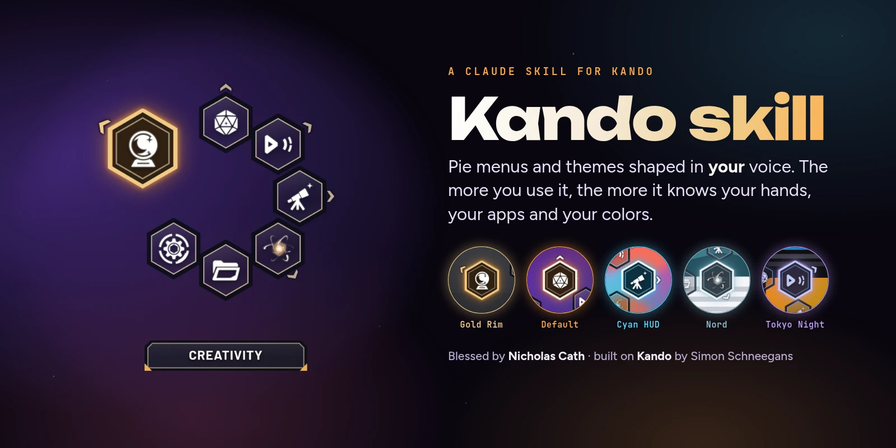
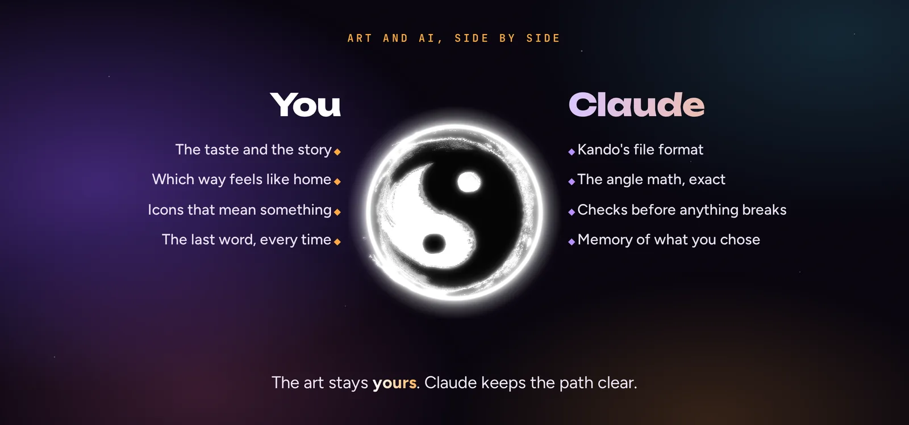
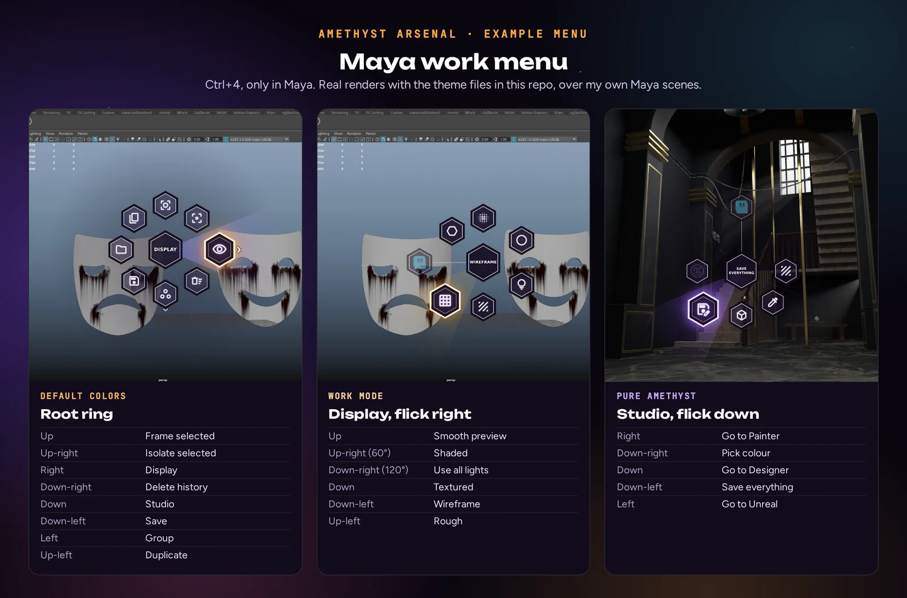
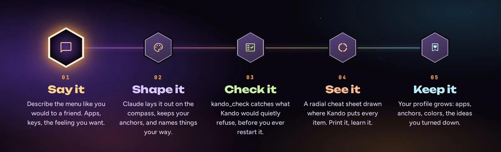
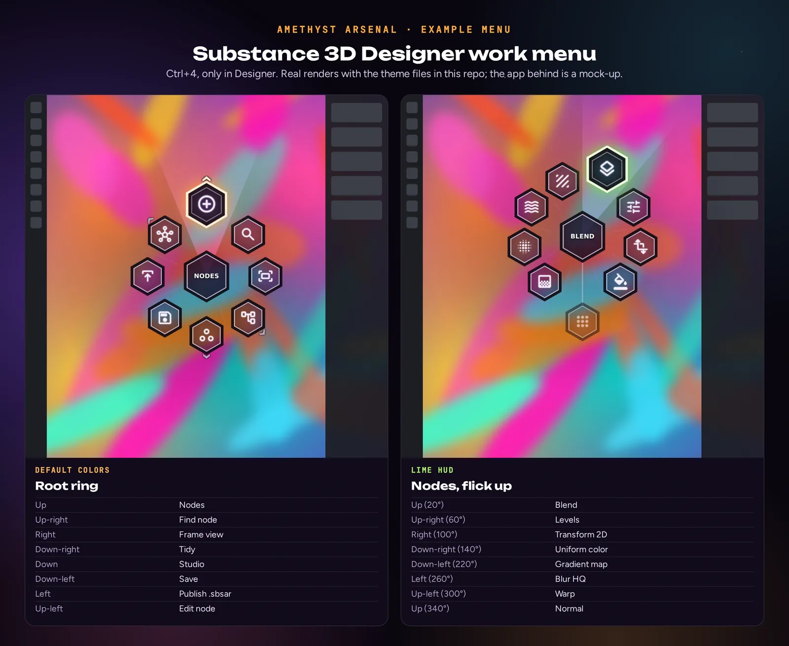
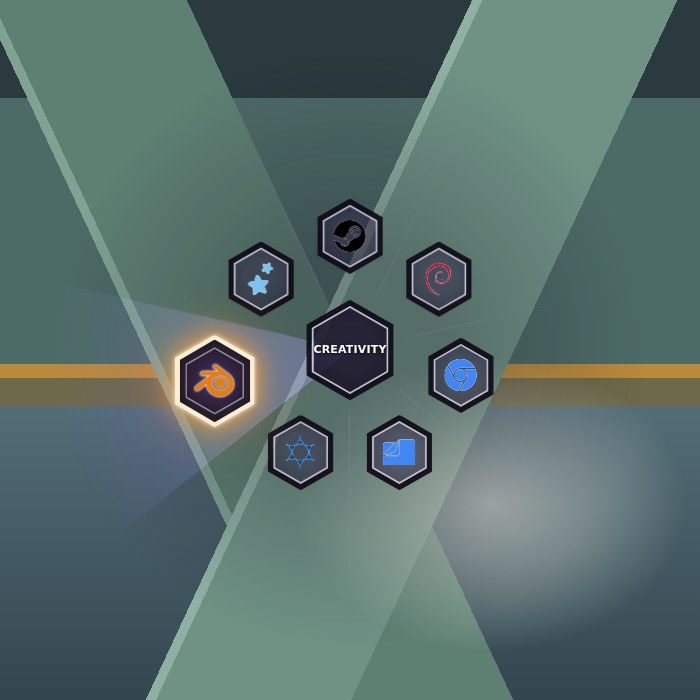
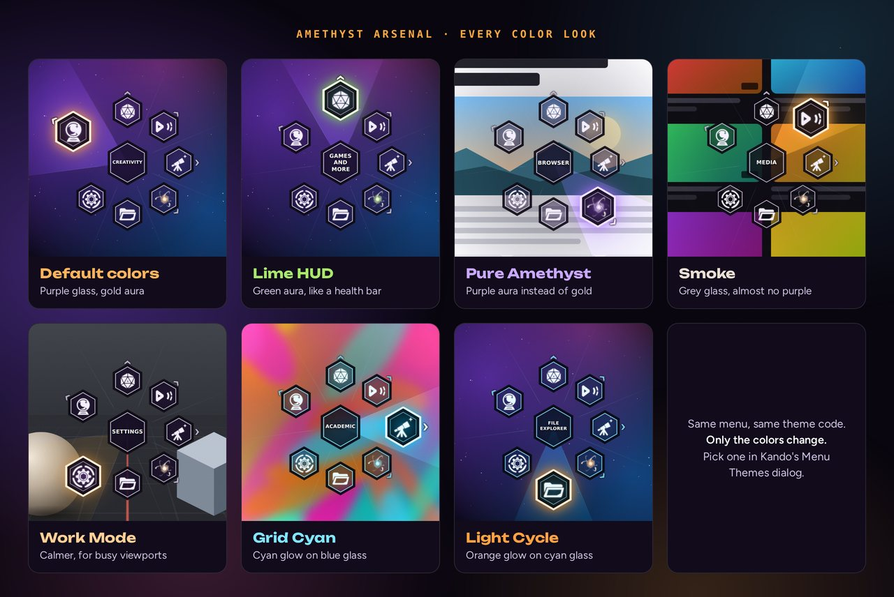
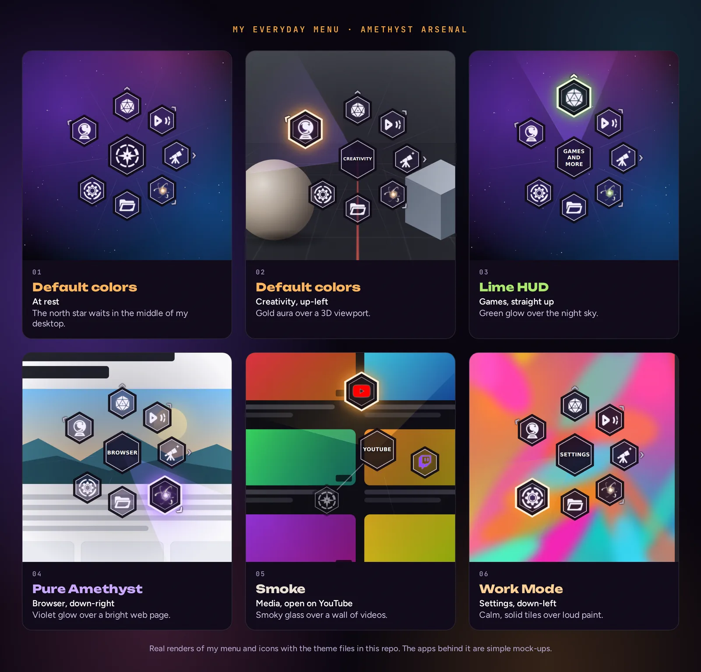

<h1 align="center">Kando skill for Claude</h1>

<p align="center">Hi, I'm <b>Nicholas Cath</b>, a 3D artist who spends most days in Maya, Substance Painter,<br>
Designer and Unreal. I made this so Claude could build my Kando menus around the way I work,<br>
and now it can do the same for you.</p>

<p align="center">
  
</p>

<p align="center">
  <a href="https://github.com/nicholascathedu/kando-skill-/actions/workflows/test.yml"></a>
  <a href="https://kando.menu"></a>
  
  
</p>

<p align="center">A Claude skill for <a href="https://kando.menu">Kando</a>, the pie menu by Simon Schneegans. It installs as a Claude Code plugin.<br>
Tell it what you want in your own words. It builds the menu, checks it, shows you a preview,<br>
and remembers how you like things for next time.</p>

<p align="center"><i>Blessed by Nicholas Cath</i></p>

---

## Why I made it

I wanna clarify that I am far from knowledgeable when it comes to coding and building apps from a development perspective. What I do know though, is how many times I’ve heard fellow artists and professionals fear AI potentially replacing their respective industry roles, or even make them “lazier” and less “precise” when it comes to problem solving. I don’t feel like it’s appropriate to argue over that, cause it could really go for hours and hours, without clear answers. As an 3D artist myself, I felt like using Kando, would make using my PC feel fresh, unique, fun again..and for sure did! What I want to emphasise on tho, is the personalisation and workflow execution speed. I wanted to create a Kando skill for Claude that personalises, builds, designs, and even optimises/enhances your Kando menus/settings for your own needs, helping you understand it, become comfy and faster with it, and reach your full potential through this amazing app made by Simon!

Claude doesn't make the art here. I decide how my menus look and feel. Claude deals with Kando's
strict file format and the angle math, tells me what it's doing as it goes, and remembers what I
picked, so next time we start further along. It's been a fun way for me to get faster in Maya,
Painter, Designer and Unreal, and I actually learned the app along the way.

## Kando first

Everything here stands on [**Kando**](https://kando.menu), made by
[Simon Schneegans](https://github.com/Schneegans), a developer from Germany. It's his third pie
menu, after Gnome-Pie and Fly-Pie: free, open source, and on Windows, macOS and Linux. Kando
already gives you the menus, a good editor, themes and 14 kinds of actions. Adding an app to a
menu takes a few clicks in the editor, and you don't need this skill for that.

If Kando makes your days faster like it did mine, [support Simon on Ko-fi](https://ko-fi.com/schneegans)
or [GitHub Sponsors](https://github.com/sponsors/Schneegans).

## What the skill adds

The skill is for the part after the basics: chaining Kando's actions into workflows, and laying
menus out so your hand learns them. These are in the repo now:

| What | What it does for you |
|---|---|
| Save everything | One flick saves Maya, Painter, Designer and Unreal in turn, with the right wait between apps. |
| One key, one menu per app | Ctrl+4 opens the Maya menu in Maya, the Unreal menu in Unreal and so on, with the same flick doing the same job everywhere (Down-left is always Save). |
| Unreal view-mode pie | All eight view modes, each one where you'd expect it, two flicks away. |
| Designer node palette | Eight favourite nodes on one ring, instead of searching the node menu. |
| Colour pick and paste | Pick a colour anywhere on screen and paste its hex into Painter or Designer. |
| A checker built from Kando's code | Finds key names Kando doesn't know, angles it will ignore, regexes that make it throw an error, and keys sent before the right window is in front. You get the fix, not just the error. |
| A review of your own menus | Reads your menus and points at what slows you down: items that move between menus, crowded rings, submenus with something on the way back out. |
| Themes from words | *"Dark purple glass, a gold glow"* becomes a color preset or a full theme. My Amethyst Arsenal theme was made this way. |
| Memory | A small profile keeps the directions you've settled on and the ideas you turned down, so the next session builds on them. |

It's all a few short Python scripts with nothing to install, tested on Windows, macOS and Linux.

## Does it actually help?

I tested it on real tasks, three runs each with the skill and three without, scored by pass or
fail rules. Across the twelve general tasks it scored 0.89 against 0.60. On three tasks taken
from my own setup it went 9 out of 9 against 1.6.

| Task | With | Without |
|---|---|---|
| A 19-action Maya work menu, split into submenus | 3/3 | 1/3 |
| A Blender menu with a Shading submenu | 3/3 | 0/3 |
| Designer added to my Maya, Painter and Unreal work menus, same layout in all four | 3/3 | 1/3 |
| A new color preset for my theme | 3/3 | 0.6/3 |
| "Smoke and amethyst" colors on the Default theme | 2/3 | 0/3 |
| Fixing a broken menus.json | 3/3 | 3/3 |

Without the skill, Claude left items on the way back out of submenus and set angles Kando
ignores, so items landed somewhere nobody chose. It also saved presets where Kando never looks.
Where plain Claude already knew the answer, like fixing broken JSON, the scores tie. It lost
one task, and that's in [`evals/`](evals) with everything else, so you can rerun it.

## Art and AI, side by side

<p align="center"></p>

I make art, and I didn't want a tool that makes it for me. I wanted help with the boring parts,
like the file format, the angles and keeping track of everything. Which icon goes at the top,
which color glows when I reach for it, which direction my hand already knows: I still decide all
of that.


## My Maya menu

Maya is where I spend most of my day, so it got the first work menu. It opens on Ctrl+4, but only
in Maya. Everywhere else the same key opens my everyday menu.

<p align="center"></p>

- Up frames the selection (F). I do that constantly, so it gets the easiest flick.
- Down-left is Save and Down is "Studio" in every app I work in. From Maya, Down then Right goes
  to Painter, Down then Down to Designer, and Down then Left to Unreal. Down then Down-left saves
  Maya, Painter, Designer and Unreal in one go.
- Right opens Display, with Smooth preview, Shaded, Textured, Wireframe and the rest. Left is the
  way back out, so I keep it empty and never hit Wireframe by accident on my way out.
- The menu is in [`examples/3d-work-menus.json`](skills/kando/examples/3d-work-menus.json), next to
  the Painter, Unreal and Designer ones.

## How it works

<p align="center"></p>

1. Say it: *"A Maya menu, only in Maya, fast for modeling."*
2. Shape it: Claude lays it out on the compass, keeps the directions you already use, and names
   things the way you do.
3. Check it: `kando_check.py` catches mistakes before Kando loads the file.
4. See it: `kando_preview.py` prints the compass outline, and it can draw a printable cheat sheet
   with every item exactly where Kando will put it.
5. Keep it: your profile saves what you chose, so next time you can say less.

Here's what the checker's output looks like:

```text
$ python kando_check.py menus.json
ERROR  [Quick] > Save > selectWorkflow[1]
       'Ctrl' in hotkey 'Ctrl+S' is not a key code. Did you mean 'ControlLeft'?
WARN   [Maya] > Display
       'Wireframe' (270°, Left) sits on the way back to the parent (270°).
       Flicking that way is ambiguous; move it at least 45° away.
TIP    shortcut control+4
       Every menu on this shortcut has conditions. In any other app the key is
       still swallowed but no menu opens. Add a fallback menu with no conditions,
       or, if another app needs this key, move the menus to a combo nothing uses.
```

## A workflow for Substance 3D Designer

Designer is where I build materials from nothing: noise and patterns become a height map, the
height map becomes normal, AO and curvature, and all of it ends up as a .sbsar that Painter and
Unreal can open. It also has a lot of small keys spread across three views, and that's
where a pie menu really helps.

<p align="center"></p>

- Up opens my node palette, eight nodes I add all the time, each bound to a key in Designer's
  Preferences. Clicking the center opens the full node menu instead (Space).
- Left publishes the .sbsar (Ctrl+P). In Painter, Left exports textures, so Left always means
  "send it out".
- Down twice jumps to Painter, and Down twice in Painter comes back. Down is "Studio" in every
  work menu, and Designer is straight down inside it from Maya, Painter and Unreal.
- Every key comes from Adobe's current Designer docs (version 16.0). The menu is in
  [`examples/3d-work-menus.json`](skills/kando/examples/3d-work-menus.json), with notes in
  [`app-recipes.md`](skills/kando/references/app-recipes.md).

## It remembers you

The first time you work together, Claude offers to write a `kando-profile.md` next to your
`menus.json`. `kando_profile.py` drafts it from the menus you already have: your shortcuts, the
apps you work in, the directions each menu uses, the items that sit in the same place everywhere
(your anchors), and the ones that drift between menus. Then you and Claude add the human part:
palette words, how you like things named, the workflows you care about, the ideas you turned down.

After that, Claude reads it before anything else. Your anchors stay where they are, new menus use
your naming and your colors, and ideas you turned down don't come back. It never writes the file
without your OK, and it keeps paths, IDs and secrets out of it.

## Showcase

### Amethyst Arsenal

<p align="center"></p>

I still remember the weapon wheel in *Ratchet & Clank Future: A Crack in Time*. You open a ring of
glowing tiles in the middle of a fight, flick once, and you're back in with exactly what you
needed. Kando gives a desktop that same feeling, so I made a theme as a tribute to it: smoky hex
tiles you can see through, a dark frame, and a soft gold aura on the one you're reaching for, all
in amethyst purple.

The gold aura look is what Kando lists as Default colors. It comes with six presets: Lime HUD,
Pure Amethyst, Smoke, Work Mode (a calmer one for busy 3D viewports), and two Tron-style looks
called Grid Cyan and Light Cycle. [Install it from `themes/amethyst-arsenal`.](themes/amethyst-arsenal)

<p align="center"></p>

### My everyday menu

My everyday menu has a north star in the middle, since every direction starts from there. The
icons are the [Amethyst Emblems](icon-themes/) set from this repo, all drawn in the same style so
the ring looks like one set.

The tiles are glass, so whatever I'm working in still shows through. Here it is over a few
different apps, in the default colors and each preset, with a different item picked each time.

<p align="center"></p>

## Install

**Claude Code** (as a plugin, Claude Code 2.1.275 or later)

```text
/plugin install kando --marketplace nicholascathedu/kando-skill-
```

On older versions, run `/plugin marketplace add nicholascathedu/kando-skill-` and then
`/plugin install kando@blessed`. To install only the skill instead:

```bash
git clone https://github.com/nicholascathedu/kando-skill-
cp -r kando-skill-/skills/kando ~/.claude/skills/
```

**Claude apps:** zip the `skills/kando` folder and upload it in Settings → Capabilities → Skills.

The scripts need Python 3.9+ and nothing else, and they're tested on Windows, macOS and Linux.
They run on their own too. Without a path they find Kando's own `menus.json` (in `%APPDATA%\kando`
on Windows, `~/Library/Application Support/kando` on macOS, `~/.config/kando` on Linux, or the
Flatpak folder):

```bash
python skills/kando/scripts/kando_check.py
python skills/kando/scripts/kando_preview.py --html sheet.html
python skills/kando/scripts/kando_profile.py --out kando-profile.md
python skills/kando/scripts/kando_check.py path/to/menus.json   # any other file
```

The plugin also comes with a small hook I call the menu guard. Kando reloads `menus.json` the moment it
changes, so before Claude edits that file the guard copies it into a `claude-backups` folder
next to it (the newest 10 are kept). After the edit it runs `kando_check.py`. If the edit broke
the JSON, it puts the copy back; if the checker finds errors, Claude sees them and fixes them
in the same turn. It only touches a `menus.json` in a Kando config folder, needs Python 3.9+,
and does nothing if Python isn't there. Edits a script makes from the shell don't trigger it.

**Mouse side buttons.** Kando opens menus from keyboard shortcuts, so mouse buttons usually need
a helper app like AutoHotkey. On Windows the skill comes with a small PowerShell script instead,
[`kando-mouse-buttons.ps1`](skills/kando/scripts/windows/kando-mouse-buttons.ps1), which uses
only what's built into Windows. While it runs, the Forward side button holds Ctrl and taps F13,
so a menu on `Control+F13` opens and turbo mode works: hold the button, move, let go. The button
stops doing Forward while the script runs, it can't reach apps running as admin, and some games'
anti-cheat block simulated keys, so stop it before playing those.

```powershell
powershell -ExecutionPolicy Bypass -File skills\kando\scripts\windows\kando-mouse-buttons.ps1
powershell -ExecutionPolicy Bypass -File skills\kando\scripts\windows\kando-mouse-buttons.ps1 -InstallStartup
```

## Try asking

| You say | Claude does |
|---|---|
| "Look at my Kando menus. What would make them faster?" | Reads your files and profile, checks and previews them, then suggests changes ring by ring |
| "Make me a Maya menu that only shows in Maya." | Designs the compass layout, writes the JSON, checks it, shows the sheet |
| "I edited menus.json and now nothing changes." | Finds the error Kando hit and fixes it |
| "I want it to feel like smoke and amethyst." | Builds a palette, then a color preset or a full theme |
| "Remember that up is always Save for me." | Adds it to your profile as an anchor and keeps it in every menu |
| "How do I open Kando with my mouse's side button?" | Walks you through mapping a spare key and using turbo mode |

## What's inside

```text
skills/kando/
├── SKILL.md              the workflow Claude follows
├── references/           menus.json format · settings · navigation · menu design
│                         themes · app hotkeys (Maya, Painter, Designer, Unreal,
│                         Blender, ZBrush, Photoshop, Illustrator) · cross-app macros
│                         your profile · sources
├── scripts/
│   ├── kando_check.py      validator and linter
│   ├── kando_preview.py    compass outline and radial HTML cheat sheet
│   ├── kando_profile.py    drafts your personal profile from your menus
│   ├── kando_layout.py     Kando's placement algorithm, ported
│   └── windows/            kando-mouse-buttons.ps1: side buttons, no extra app
└── examples/             a desktop launcher, Maya / Painter / Designer / Unreal work
                          menus, and ZBrush / Blender / Photoshop / Illustrator menus
hooks/                    the menu guard: backs up and checks menus.json on every edit
themes/
└── amethyst-arsenal/     a Kando menu theme (CC0), drop it in your menu-themes folder
icon-themes/
└── amethyst-emblems/     matching icons (CC0), drop them in your icon-themes folder
tests/                    python -m unittest discover -s tests
evals/                    real tasks that score Claude with and without the skill
.claude-plugin/           plugin and marketplace manifests
```

## Sources and credits

- **Kando** is made by [Simon Schneegans](https://github.com/Schneegans) and its contributors,
  MIT licensed. The skill was built from Kando's official docs at [kando.menu](https://kando.menu),
  its source code (the settings schemas, the placement math and the actions) and Simon's videos,
  for **Kando 3.0**. Where the docs and the code disagree, the skill follows the code; the
  differences are listed in [`references/sources.md`](skills/kando/references/sources.md).
- The Amethyst Arsenal theme builds on the tile positioning of Kando's built-in Default theme by
  Simon Schneegans (CC0).
- *Ratchet & Clank* is a trademark of Sony Interactive Entertainment LLC. Amethyst Arsenal is a fan
  tribute that uses none of the game's files and is not affiliated with or endorsed by Insomniac
  Games or Sony Interactive Entertainment.
- This skill is an independent project and is not affiliated with Kando or Anthropic.
- App logos in the artwork come from [Simple Icons](https://simpleicons.org) and belong to their owners.

Made by **Nicholas Cath**, for my own desk first. The skill is MIT licensed and the theme is CC0,
so feel free to take them and change them however you like.
