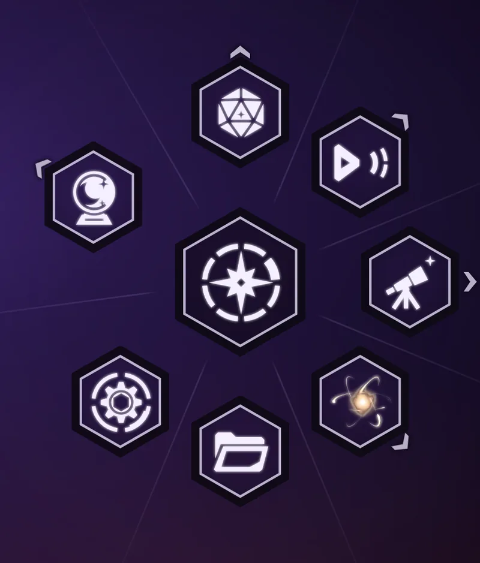

# Amethyst Emblems

A Kando icon theme drawn to match the [Amethyst Arsenal](../themes/amethyst-arsenal/) menu theme:
flat space emblems in a single color, so they let the theme's purple glass and gold aura do the
work in every color preset.

| File | Use it for |
| --- | --- |
| `center.svg` | the menu's center: a north star inside a ring of eight wedges, one selected |
| `games.svg` | games: a twenty-sided die |
| `media.svg` | video and music: a play mark with signal arcs |
| `academic.svg` | study: a telescope pointed at a star |
| `files.svg` | file explorer: an open folder |
| `settings.svg` | settings: a gear inside a HUD ring |
| `creativity.svg` | art apps: a crystal ball with the moon and stars cut into the glass |

## Install

1. Copy the `amethyst-emblems` folder into the `icon-themes` folder of your Kando config:
   `%APPDATA%\kando\icon-themes\` on Windows, `~/Library/Application Support/kando/icon-themes/`
   on macOS, `~/.config/kando/icon-themes/` on Linux. Create `icon-themes` if it is missing.
2. Restart Kando.
3. In the menu editor, pick an item, open its icon picker, choose the **amethyst-emblems** theme
   and click an icon.

In a `menus.json` an item points at one like this: `"iconTheme": "amethyst-emblems", "icon": "games.svg"`.

The icons use `currentColor`, so they take the icon color of whatever menu theme or preset you
use. Each file is a single path under 1.2 KB, so the menu opens without waiting on them.

## One style for every icon

Every icon follows the rules in [`amethyst-emblems.style.json`](amethyst-emblems.style.json):
48-unit grid, one solid path, cut lines 1.7 units wide, no detail thinner than 1.3 units, ink
between 15% and 30% of the square, centered within 0.75 units. The repo's tests check the files
against it, and each icon was checked at 24, 40 and 96 pixels before it went in. If you draw a new
icon to the same rules, it'll fit in with the rest.

## License

CC0 1.0, so you can use, change and share them freely without credit. I drew them as plain SVG
paths for this project. Reference pictures only guided the style, and nothing was traced or copied.
