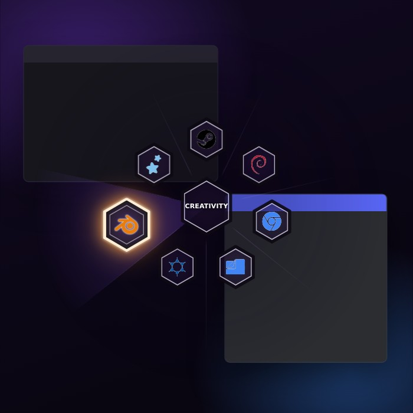

# Amethyst Arsenal

A menu theme for [Kando](https://kando.menu) 3.0, the cross-platform pie menu.

I based it on the weapon wheel from *Ratchet & Clank Future: A Crack in Time*: hex tiles with a dark frame and a see-through face, and a soft gold aura on the item you pick. Mine adds a dark purple tint.

## What it looks like

- Every item is a hex tile with a dark frame, a thin light line, and a see-through purple face, so the app behind the menu shows through.
- The selected tile pops out with a cream frame, a dark face with a purple glow in the middle, and a soft gold aura.
- The center tile shows the selected item's name in bold capitals.
- Black logos like Steam or Unreal Engine get a thin light outline, so they stay visible on the dark tiles.
- Items that open a submenu have a small arrowhead on their outer edge, pointing the way the submenu opens. It turns cream on the selected tile.
- With quick-select keys turned on, each tile shows its key as a small controller-style button.
- With item wedges turned on, the direction you point at lights up softly.

## Install

1. Download this folder (`amethyst-arsenal`) and put it in Kando's `menu-themes` folder:

   | System | Folder |
   |---|---|
   | Windows | `%appdata%\kando\menu-themes\` |
   | macOS | `~/Library/Application Support/kando/menu-themes/` |
   | Linux | `~/.config/kando/menu-themes/` |
   | Linux (Flatpak) | `~/.var/app/menu.kando.Kando/config/kando/menu-themes/` |

   You should end up with `menu-themes/amethyst-arsenal/theme.json5`.

2. Restart Kando.
3. Open Kando's settings, go to **Menu Themes**, and pick **Amethyst Arsenal**. If you use a separate dark-mode theme, pick it there too.

### Optional settings that suit the theme

Two switches in the **Menu Themes** dialog go well with it. **Draw item wedges** lights up the direction you point at, and **Draw quick-select key** shows each item's key as a button on its tile.

## Color presets

In Kando's Menu Themes dialog, the preset list shows **Default colors**, which is the theme's own look, and the six presets from the `presets` folder:

| Name in Kando | Look |
|---|---|
| Default colors | Purple glass with a gold aura (the theme's own colors, not a preset file) |
| Lime HUD | Green aura, like a game health bar |
| Pure Amethyst | Purple aura instead of gold |
| Smoke | Grey glass with almost no purple |
| Work Mode | Less see-through and a softer glow, for busy apps like 3D viewports |
| Grid Cyan | Cyan glow on blue glass |
| Light Cycle | Orange glow on cyan glass |

## Make it your own

- To change colors, use the theme's colors in Kando's settings, or edit the `colors` list in `theme.json5`. Each color has a comment saying what it paints, and transparency works, for example `rgb(40 22 68 / 0.40)`.
- For sizes, glow and speed, open `theme.css` and edit the "Tweak me" block at the top. You can change tile size, frame thickness, icon size, how much the selected tile grows, how far the aura reaches and how fast things animate.
- To see changes live, open Kando's **General Settings**, go to the **Developer Options** tab and click **Reload menu theme**. CSS changes show up right away, and changes to `theme.json5` show up the next time you open a menu.
- If you make tiles, spacing, the hover scale or the aura bigger, raise `maxMenuRadius` in `theme.json5` too. It keeps the menu far enough from the screen edge that the selected tile and its aura don't get cut off, and its comment shows the math.
- If you don't want the submenu arrowheads, delete the "Submenu marker" block in `theme.css`.

## Compatibility

- Made for Kando 3.0 (theme engine version 1) and checked against Kando 3.0.1's menu code.
- Checked with 1 to 20 items. Menus with more than 9 items spread out so tiles keep their spacing. It looks best with up to 8 items per ring.
- Near a screen edge, menus of up to 12 items keep the selected tile and its aura on screen. Bigger menus can touch the edge.
- It works with every icon type Kando supports: app icons, icon fonts, emoji and images.
- It's light on slower PCs (since 1.2.0). Only position, size and fade are animated, so the glow isn't redrawn on every frame while you hover. In a browser test with the CPU slowed six times, slow frames dropped from about 30 to about 4 per run. Big image icons (hundreds of KB each) still cost time when a menu opens, so small SVG or font icons keep it fastest.
- Turning off **Menu Animations** in the Menu Themes dialog, or turning on your system's "reduce motion" setting, switches off all animation. Hover and selection still change at once.

## Credits and license

- Theme by [nicholascathedu](https://github.com/nicholascathedu), released under [CC0-1.0](https://creativecommons.org/publicdomain/zero/1.0/): use, change and share it however you like.
- Tile positioning is based on Kando's built-in Default theme by Simon Schneegans (CC0-1.0).
- The look is inspired by the weapon wheel in *Ratchet & Clank Future: A Crack in Time*. This is a fan-made tribute that does not use any of the game's files. It is not affiliated with or endorsed by Insomniac Games or Sony Interactive Entertainment. Ratchet & Clank is a trademark of Sony Interactive Entertainment LLC.
