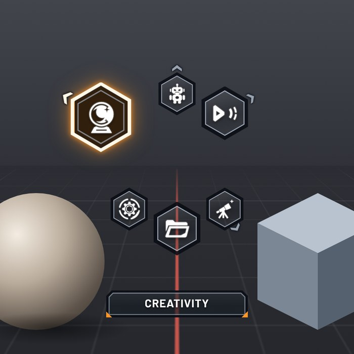
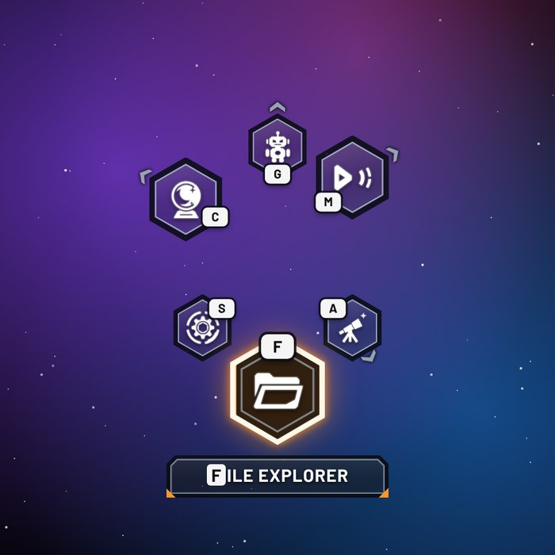
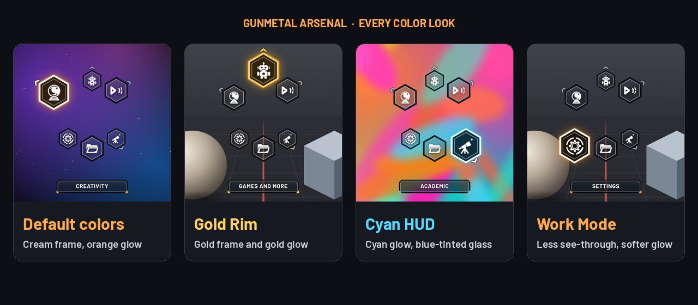

# Gunmetal Arsenal

A menu theme for [Kando](https://kando.menu) 3.0, the cross-platform pie menu.

This one stays close to the weapon wheel from *Ratchet & Clank Future: A Crack in Time*: a tight ring of clear glass hex slots with dark gunmetal frames, a cream and orange selected slot, and the name of what you picked on a plate under the ring. If you want the looser purple take on the same idea, use its sibling, [Amethyst Arsenal](../amethyst-arsenal).

## What it looks like

- The items sit in a tight ring with nothing in the middle, like the wheel in the game. The middle still works as usual: point there to go back or cancel. To show the menu's icon there, set `--hub-opacity` to 1 in `theme.css`.
- In menus with an even number of items, every second slot is a little smaller, which gives the game's honeycomb look. Set `--back-scale` to 1 for equal slots.
- Every slot has a dark frame, a thin steel line and a face of clear glass with a faint sheen, so the app behind the menu shows through. The selected slot and the name plate are see-through too.
- The selected slot pops out at full size with a cream frame, a dark face and a tight orange glow.
- The selected item's name shows in bold capitals on a plate under the ring, with a dark frame, a steel line and two small orange corner marks. Long names wrap to a second line and the plate grows with them.
- When a submenu opens upward, the plate moves above the ring, so it never covers the way back.
- Black logos like Steam or Unreal Engine get a thin light outline, so they stay visible on the clear glass.
- Items that open a submenu have a small arrowhead on their outer edge, pointing roughly the way the submenu opens.
- With quick-select keys turned on, each slot shows its key as a small white button on its inner edge, and the key's letter in the name turns into the same button, like the game's "R1" prompt.
- The matching [Amethyst Emblems](../../icon-themes/) set has a robot icon (`robot.svg`) made for this theme's Games slot.

## Install

1. Download this folder (`gunmetal-arsenal`) and put it in Kando's `menu-themes` folder:

   | System | Folder |
   |---|---|
   | Windows | `%appdata%\kando\menu-themes\` |
   | macOS | `~/Library/Application Support/kando/menu-themes/` |
   | Linux | `~/.config/kando/menu-themes/` |
   | Linux (Flatpak) | `~/.var/app/menu.kando.Kando/config/kando/menu-themes/` |

   You should end up with `menu-themes/gunmetal-arsenal/theme.json5`.

2. Restart Kando.
3. Open Kando's settings, go to **Menu Themes**, and pick **Gunmetal Arsenal**. If you use a separate dark-mode theme, pick it there too.

On Windows the plate uses Bahnschrift, a font that comes with Windows 10 and 11. Elsewhere it falls back to Segoe UI or your system font.

## Color presets

| Name in Kando | Look |
|---|---|
| Default colors | Clear glass, cream frame, orange glow (the theme's own colors, not a preset file) |
| Gold Rim | Gold frame, gold glow and warm steel lines |
| Cyan HUD | Cyan glow and blue-tinted glass |
| Work Mode | Less see-through and a softer glow, for busy apps like 3D viewports |

## Make it your own

- To change colors, use the theme's colors in Kando's settings, or edit the `colors` list in `theme.json5`. Each color has a comment saying what it paints.
- For sizes, glow and speed, open `theme.css` and edit the "Tweak me" block at the top: ring size, slot size, frame thickness, icon size, how much the selected slot grows, how far the glow reaches, the gap to the plate and the plate's font size.
- To see changes live, open Kando's **General Settings**, go to the **Developer Options** tab and click **Reload menu theme**.
- If you make the ring, the slots, the hover scale or the plate bigger, raise `maxMenuRadius` in `theme.json5` too. Its comment shows the math.
- If you don't want the submenu arrowheads, delete the "Submenu marker" block in `theme.css`.

## Compatibility

- Made for Kando 3.0 (theme engine version 1) and checked against Kando's menu code.
- It looks most like the game with 6 to 8 items. Menus with more than 8 items spread out so slots keep their spacing, and the plate moves down with them.
- Near a screen edge, menus of up to 8 items keep the selected slot and the plate on screen. Bigger menus can push the plate against the edge.
- In a submenu that opened up and to the side, the plate can overlap the dimmed slot of the previous menu. Straight up is handled (the plate moves above).
- It works with every icon type Kando supports: app icons, icon fonts, emoji and images.
- Only position, size and fade are animated, so it stays light on slower PCs. Turning off **Menu Animations** in the Menu Themes dialog, or turning on your system's "reduce motion" setting, switches off all animation.

## Credits and license

- Theme by [nicholascathedu](https://github.com/nicholascathedu), released under [CC0-1.0](https://creativecommons.org/publicdomain/zero/1.0/): use, change and share it however you like.
- Slot positioning is based on Kando's built-in Default theme by Simon Schneegans (CC0-1.0).
- The look is inspired by the weapon wheel in *Ratchet & Clank Future: A Crack in Time*. Everything is drawn from scratch in CSS. It uses none of the game's files, fonts or logos. This is a fan-made tribute that is not affiliated with or endorsed by Insomniac Games or Sony Interactive Entertainment. Ratchet & Clank is a trademark of Sony Interactive Entertainment LLC.
